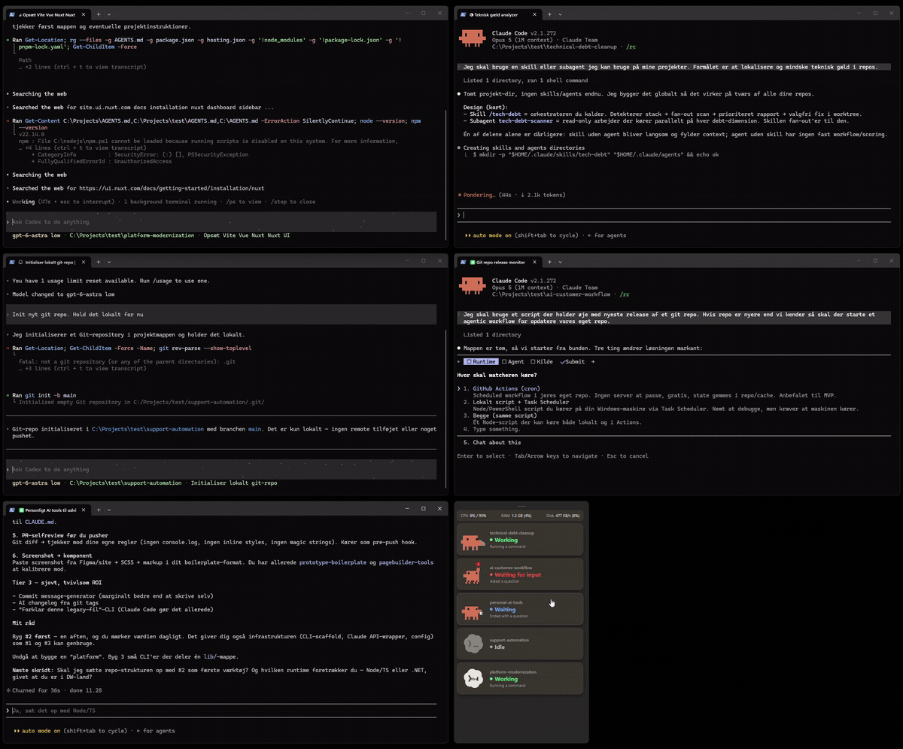

# AI Code Session Widget

> **Fork** of [kasperlegarth/ai-session-widget](https://github.com/kasperlegarth/ai-session-widget)
> (MIT). Adds a compact view, a multi-column layout, status filters and
> sorting, and optional click behaviours for Claude Desktop sessions. Installs
> side by side with the original (own product name, identifier and MSI
> upgrade code). See [What this fork adds](#what-this-fork-adds); plan,
> decisions and test protocol (German) are in [docs/fork](docs/fork/README.md).

A small always-on-top Windows widget that shows every Claude Code and Codex
session running on your machine — what each one is doing, and which ones are
sitting there waiting for you.



If you keep three or four agent sessions going at once across different
terminal windows, the annoying part isn't the work — it's noticing that one of
them finished two minutes ago, or is blocked on a permission prompt you never
saw. This sits in the corner and answers that at a glance.

Click a session and it brings that session's terminal window to the front,
with a brief highlight so you can spot it among a dozen open windows.

## Features

- **Live status per session** — Waiting for input, Question (finished with a
  question), Working or Idle, colour-coded and with an animated mascot per
  state.
- **What it's actually doing** — "Reading main.rs", "Running a command",
  "Needs permission: Bash", "Asked a question".
- **Click to focus** — brings the owning terminal window forward and flashes a
  highlight frame around it. Works even when several sessions share one
  process (e.g. multiple Windows Terminal tabs), and for sessions in Claude
  Desktop's Code tab.
- **Resource usage** — CPU, RAM and disk I/O for your sessions, next to the
  machine total, so you can see what the agents are costing you.
- **Orphaned-process warning** — flags tool processes (a runaway `find`, a
  stray `node`) left behind by a session whose parent shell already exited.
  Click it to see exactly which process(es) and end one with a confirm
  prompt.
- **Light/dark/system theme**, auto-sizing or manually resizable, always-on-top
  toggle — all from the right-click menu.

## What this fork adds

- **Status filter** — a chip per status (Waiting, Question, Working, Idle)
  with a live count; click to show/hide that status. Turning off the last
  active chip shows everything again.
- **Sorting** — by status priority (Waiting > Question > Working > Idle,
  then the most recent status change first), by session title (then folder)
  or by project folder (then title), either direction. The sort button cycles
  Status → Title → Folder.
- **Card layout: title, details, status** — the session's title first (e.g.
  the name Claude Desktop gives it, falling back to the project folder), then
  the details: what it is doing and the project folder ("Editing main.rs ·
  my-project"), then the status.
- **Compact view** — small icon, two short lines per session (folder +
  status, then title · activity) and tighter spacing.
- **Multi-column layout** — drag the left or right edge to make the widget
  wider and it shows one column per status (Waiting | Question | Working |
  Idle, only the statuses present, in sort order). With fewer columns than
  statuses the last column takes all the rest. With more columns than
  statuses, the spare columns go to the statuses with the most cards, which
  then show several cards side by side. Within a status the chosen sort
  applies. With one column, or a single status, cards simply stack.
- **Window size remembered** — width in both size modes, height in manual
  size.
- **Auto size shrinks again** — upstream's auto size could only grow (it
  measured `#app`, whose `min-height: 100%` never lets it drop below the
  current window height).
- **Auto size stops at the screen edge** — with many sessions the window
  grows only up to the monitor's work area; then the session list scrolls
  while title, chips and system status stay put.
- **Native right-click menu** — a Windows popup menu that overlaps the
  desktop and other windows, so it is never cut off and the widget no longer
  has to grow for it. Growing content never reaches below the taskbar.
- **Claude Desktop closed to the tray** — clicking one of its sessions shows
  Claude's hidden main window again instead of climbing on to explorer.exe
  and focusing some Explorer or helper window.
- **Open in Claude Desktop** (on by default): clicking a session from
  Claude Desktop's Code tab opens exactly that session via
  `claude://claude.ai/epitaxy/<hostSessionId>` — from the Chat/Cowork view
  and from the tray too. Undocumented route, verified by hand on Desktop
  2.42304.
- **Select in sidebar** (fallback, off by default): if the link is switched
  off or can't be opened, select the session in Desktop's sidebar via UI
  Automation instead, switching Desktop from Chat/Cowork to Code first.
- **Own tray picture (optional)** — put a PNG at `src/public/tray-mascot.png`
  (git-ignored) and the tray shows it instead of the built-in mascot, with
  the same status dot. It is bundled into the app; nothing is downloaded at
  runtime.
- **Tray icon** — the widget's mascot in the pose of the most urgent status
  (Waiting > Question > Working > Idle) with a dot in that status' colour
  bottom left (red, blue, green, grey); the tooltip lists all counts.
  Single click always brings the widget to the front (pinned to the
  desktop: for 5 seconds); double click does "Bring to front". Right click shows "Bring to front", "Hide widget" and the
  widget's full right-click menu, so settings work while it is hidden.
  "Bring to front" shows the widget above all windows; pinned to the
  desktop only until it loses focus (60 seconds at most), then it goes
  back onto the desktop.
- **Taskbar button** — shows the mascot in the pose of the most urgent
  status instead of the app icon, plus an overlay badge with the number of
  sessions that need you (Waiting + Question): red if any is waiting for
  input, blue if only questions. No badge when nothing needs you.
- **Own logo** — a face between curly braces as app, desktop and Start menu
  icon (sources in `assets/logo/`). With no sessions running, tray and
  taskbar button show it too (`src/public/logo.png`), instead of a mascot
  pose.
- **Title** — logo and "AI Sessions" at the left of the filter bar (full
  name as tooltip), no separate title row. Drag the widget by the title,
  any free spot of that bar, or the CPU/RAM/disk bar at the bottom.
- **Background commands** — an idle session whose shell is still running
  (dev server, watcher, long build started in the background) shows
  "Background command running" and a green ring around its grey dot,
  instead of looking finished. Counted from the process tree: bash, sh,
  zsh and PowerShell below the session process (not `cmd.exe`, which
  wraps `npx` MCP servers).
- **Time in status** — Waiting, Question and Idle show how long the session
  has been in that state ("Idle · 12 min"). Idle for an hour or more dims
  the card, so open-but-forgotten sessions stand out from ones that just
  finished.
- **No ghost sessions** — a session counts as running only if the process
  under its pid started when the session file says (`procStart`); after a
  crash or reboot an unrelated program that got the same pid is ignored.
- **Single instance** — starting the widget again (desktop icon, Start menu,
  autostart) brings the running one forward, also out of the tray, instead
  of opening a second one (installed build).
- **Installer** — the program file is `AI Code Session Widget.exe`, and the
  MSI no longer carries Tauri's hidden PowerShell step that downloads
  WebView2 when it is missing (Windows 11 ships WebView2).
- **Pin to desktop** — sits on the desktop like a gadget instead of
  floating on top: below all windows, without a taskbar button, and not
  hidden by Win+D (owned by the desktop window). Outside that mode the
  taskbar button can be switched off too.
- **Start with Windows** — a shortcut in your Startup folder, toggled from
  the menu (installed build only). Written in-process through the Windows
  Shell's link object; the widget never starts PowerShell or any other
  child process (0.3.0 did, and behaviour-based antivirus flagged it).

## Settings

All in the right-click menu, in the submenus Window (always on top, pin to
desktop, taskbar button, start with Windows), View (compact, transparent,
size, light/dark/system theme) and On session click.
Stored in the widget's WebView LocalStorage, except "Start with Windows",
which is the shortcut file itself. **About & help** at the bottom of the menu
shows a short usage summary, the version and a link to this repository.

| Setting | Default | What it does |
|---|---|---|
| Always on top | on | Keeps the widget above other windows (Win+D minimizes it like any window; use Pin to desktop to keep it visible) |
| Pin to desktop | off | Desktop-gadget mode: below all other windows, no taskbar button (the tray icon stays), still visible after Win+D; comes up above the windows while you drag it. Turns "Always on top" off; switching it off returns to always on top. |
| Show in taskbar | on | Taskbar button with the status badge; off leaves only the tray icon. Greyed out while pinned to the desktop (no button there) |
| View → Transparent background | off | Hides the window panel; title bar, cards, chips, system status, the empty-state hint and the about panel stay solid, so text stays sharp |
| View → Compact view | off | Small icon, two short lines per session (folder + status, then title · activity), tighter spacing |
| Start with Windows | off | Creates/removes `%APPDATA%\Microsoft\Windows\Start Menu\Programs\Startup\AI Code Session Widget.lnk` |
| View → Auto / Manual size | Auto | Auto fits the height to the content, at most the screen height (then the list scrolls; width stays yours); Manual leaves both to you |
| View → Light / Dark / System theme | System | Light, Dark or follow Windows |
| On session click: Open in Claude Desktop | on | Claude Desktop sessions only. Opens `claude://claude.ai/epitaxy/<hostSessionId>`, then focuses and highlights the window as usual. |
| On session click: Select in sidebar (fallback) | off | Claude Desktop sessions only, and only when the link is off or failed. After focusing Desktop, switches its mode switch to "Code" if Chat/Cowork is showing, then finds exactly one clickable element named like the session title via UI Automation and invokes it. Ambiguous titles are not clicked. Retries because Electron builds its accessibility tree on demand. |
| Filter chips, sort buttons | all statuses, Status ↓ | At the top, above the sessions (system status CPU/RAM/disk sits at the bottom); sort key Status / Title / Folder plus direction; remembered |

## Requirements

**Windows only.** The window-focusing, highlight overlay and Codex lock
detection are built on Win32 APIs (UI Automation, DWM, Restart Manager) with no
cross-platform equivalent here. It will not build on macOS or Linux. It
needs the WebView2 runtime, which is part of Windows 11; the installer does
not download it.

You also need [Claude Code](https://claude.com/claude-code) and/or
[Codex](https://developers.openai.com/codex) installed — the widget just reads
what they already write to disk.

## Install

Grab the installer from the [latest release](../../releases/latest) — either
the `.msi` or the `-setup.exe`. That's it; there's nothing to configure.

### Build it yourself

Needs [Rust](https://rustup.rs/), [Node.js](https://nodejs.org/) 22.18+, the
MSVC build tools (C++ workload incl. Windows SDK), and the WebView2 runtime
(preinstalled on Windows 11).

```bash
npm install
npm run tauri dev     # run it
npm run tauri build   # produce installers in src-tauri/target/release/bundle/
```

## How it works

Both agents already keep a record of their running sessions on disk. The widget
polls those every two seconds, read-only:

| | Claude Code | Codex |
|---|---|---|
| Which sessions are live | `~/.claude/sessions/<pid>.json` | held `~/.codex/thread-writer-locks/<id>.lock` |
| What it's doing | tail of `~/.claude/projects/<dir>/<sessionId>.jsonl` | `~/.codex/sessions/YYYY/MM/DD/rollout-*.jsonl` |

Sessions from Claude Desktop's Code tab show up too: Desktop runs the Claude
Code CLI as a child process, which writes the same session file. While a
permission prompt is open, Claude Code sets `"status": "waiting"` with
`"waitingFor": "permission prompt"` there, which the widget shows as
"Waiting for input" (verified with Claude Code 2.1.299). The fork
additionally reads `statusUpdatedAt` (to seed "time in current state" for
sorting) and `hostSessionId` (Claude Desktop's own `local_…` id, used to
open the session directly) from that file.

**No hooks, config changes, API keys or wrappers are required.** The widget
never writes to those session/project files and never talks to any network
service. It's read-only apart from things you explicitly trigger yourself:
focusing a window (calls Win32 to bring it to the foreground), ending an
orphaned process from the warning panel (asks for confirmation, then re-checks
the pid still matches before terminating it — never done automatically),
opening a Claude Desktop session via its `claude://` link when you click it
(can be switched off), and — only if you switch them on — selecting a
sidebar entry via UI Automation and creating the Startup shortcut.

See [docs/codex-sessions.md](docs/codex-sessions.md) for the Codex specifics.

### The honest caveat

Neither of these formats is a documented, stable public API — they're internal
files that happen to be readable. A Claude Code or Codex update can change them
and quietly break status detection. The adapter is written defensively
(malformed lines are skipped, missing files degrade to "no activity" rather
than crashing), but if a release breaks something, please open an issue.

Verified against Claude Code 2.1.x and Codex 0.154.0.

## Tech

Tauri 2, a Rust backend, and a vanilla TypeScript + CSS frontend — no UI
framework. The mascot is hand-built SVG. Filter/sort logic lives in
`src/sessionOrder.ts` (pure functions, unit-tested).

## Contributing

`cargo test --manifest-path src-tauri/Cargo.toml`, `npx tsc --noEmit` and
`npm test` all run in CI and should stay green.

## License

MIT — see [LICENSE](LICENSE). Original work © Kasper Legarth, changes in
this fork © Michael Goldschmidt, including the logo and app icons
(`assets/logo/`, `src/public/logo.png`, `src-tauri/icons/`).

Not affiliated with, endorsed by, or sponsored by Anthropic or OpenAI. "Claude"
and "Codex" are the trademarks of their respective owners. The Codex mark is
from [lobe-icons](https://github.com/lobehub/lobe-icons) (see
[codex.LICENSE](src/mascot-svgs/codex.LICENSE)).
